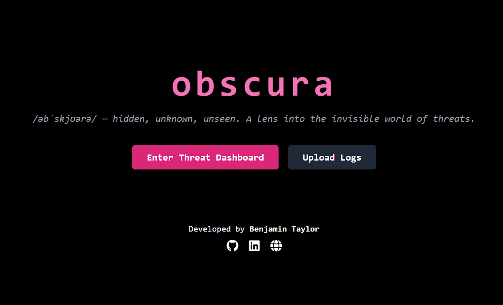
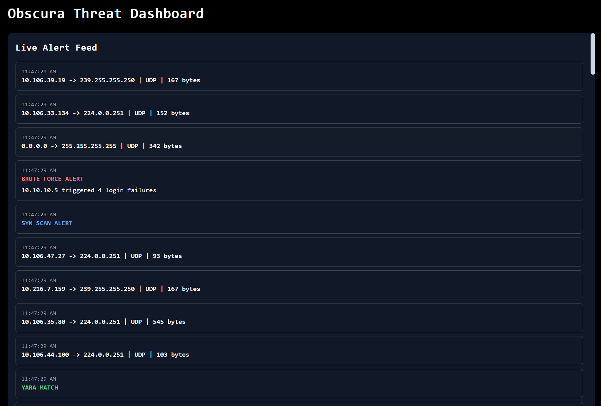
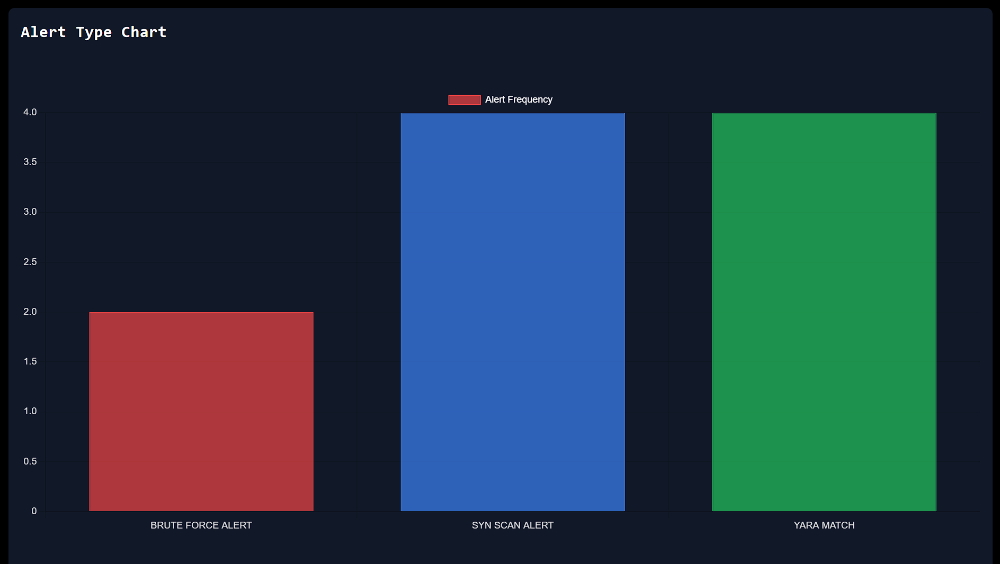

<p>
  
</p>

---

# Obscura Threat Intelligence Dashboard

**Obscura** is a real-time threat analysis platform for Security Operations Center (SOC) simulation and cyber threat hunting, created as a solo full-stack project by Benjamin Taylor.

It features live PCAP parsing, rule-based alert detection (YARA, SYN scan, brute-force detection), and a custom-built frontend dashboard using **React**, **TailwindCSS**, and **Chart.js**. This project was designed to showcase advanced cybersecurity skills across full-stack dev, threat detection, and cloud-ready deployment pipelines.

> /ˌɑbˈskjʊrə/ — _hidden, unknown, unseen._  
> A lens into the invisible world of threats.

## Obscura Usage

To get started with Obscura, you need to have access to the private repository. For security reasons, the source code is not publicly available. However, this `README.md` is public to showcase legitimacy and technical depth.

If you're a recruiter coming from LinkedIn and would like to verify the implementation, feel free to [DM me on LinkedIn](https://www.linkedin.com/in/btayl106). We can arrange a guided source review or discuss appropriate repository access.


## Prerequisites

Make sure your local system is equipped with:

- [Node.js](https://nodejs.org/) and npm
- [Python 3](https://www.python.org/downloads/)
- [pip](https://pip.pypa.io/en/stable/)
- [Docker](https://www.docker.com/)
- [Visual Studio Code + Dev Containers Extension](https://code.visualstudio.com/docs/devcontainers/containers)

You’ll also need basic familiarity with:

- Terminal / command line
- React / Flask basics


## Workflow Overview

This is the development workflow I follow when building out Obscura.

### 1. PCAP Collection & Parsing
- Gather `.pcap` files from simulated or real traffic.
- Parse with `pyshark` in a Python backend script.
- Extract and normalize packet metadata.

### 2. Threat Detection
- Run parsed data against custom rules:
  - ✅ YARA rule matches
  - ✅ SYN scan behavior
  - ✅ Brute force login heuristics
- Log alerts into `logs/alerts.log` in real time.

### 3. React Frontend & Live Feed
- TailwindCSS + React + Chart.js frontend
- Fetches live alerts via `/alerts` endpoint
- Displays logs in a scrollable feed
- Charts update on interval to show attack frequency

### 4. Upload & Analysis
- User can upload `.pcap` files
- Flask backend re-parses and applies detection
- Frontend instantly reflects new alerts

### 5. Deployment
- Dockerized backend + frontend
- Ready for Render deployment
- Public-facing dashboard with source review available on request


## Dev Setup Instructions

```bash
# Clone the repository
# Requires access to the private repository
git clone https://github.com/benjqminn/obscura.git
cd obscura

# Set up virtualenv and install dependencies
python3 -m venv venv
source venv/bin/activate
pip install -r requirements.txt

# Install frontend dependencies
cd obscura-dashboard
npm install

# Start Flask backend
cd ../obscura
python server.py

# Start React frontend
cd ../obscura-dashboard
npm run dev
```

Visit `http://localhost:3000` to use the dashboard.


## Features

- 🔍 **Real-time packet analysis**
- ⚡ **Live alert feed** for:
  - SYN scans
  - Brute-force login attempts
  - YARA rule matches
- 📊 **Interactive bar chart** showing alert types
- 🧠 **Smart upload system**: reprocesses `.pcap` files and updates alerts
- 🌐 **Modern UI/UX** with TailwindCSS, dark mode, hover effects
- 🔒 **Private implementation; source review available on request**


## Future Roadmap

- [ ] Red vs Blue simulation toggle
- [ ] VirusTotal API integration
- [ ] Twilio or Discord alert integration
- [ ] ELK or MongoDB long-term storage backend
- [ ] Cloud deployment with Terraform and GitHub Actions


## Screenshots

### Landing Page


### Live Alert Feed


### Alert Type Visualization



## Contact

If you’re a recruiter or engineer interested in the code:
- 🔗 [DM me on LinkedIn](https://www.linkedin.com/in/btayl106)
- Contact me on LinkedIn to arrange a guided source review or discuss appropriate repository access.

Thank you for checking out **Obscura**, my full-stack, real-time SOC simulation & threat dashboard project.


